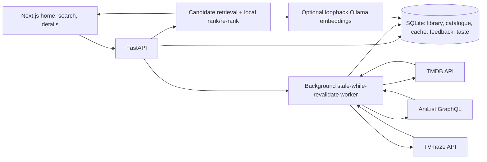

# Architecture

Manu AI runs as a local-first single-user app. Public-provider adapters only receive public catalogue or title search requests. Ranking reads the user's library and preferences locally.

## Runtime flow

1. The home route reads the stored section snapshots and returns immediately.
2. Missing or expired snapshots schedule one background worker; it calls only the providers with stale sections, with bounded provider and endpoint concurrency.
3. Successful results are normalized/upserted by `(source_provider, provider_id)` and attached to section cache rows with fetch/expiry/error times.
4. Provider errors do not delete cached titles. The section keeps its previous catalogue IDs and reports stale data/error state.
5. A title detail view refreshes the selected TMDB record on demand, including India availability, cast, trailer and public source metadata.
6. Feedback is an append-only event with undo state. A watchlist/watched action can also update the private media library; undo restores or removes that linked library row.

The browser never receives provider credentials. External poster and backdrop URLs are accepted only from the provider's official image hosts. Catalogue metadata is public; `MediaItem`, `Memory`, and `TasteSignal` are local-only profile inputs.

## Ranking

Candidate retrieval uses provider sections and search results plus locally cached catalogue rows. A local deterministic ranker combines positive/negative explicit signals, highly/poorly rated titles, repeated feedback on multiple distinct titles, item-specific feedback, local text overlap, vote-aware public quality, temporary modes/moods, seen-title suppression, and genre/franchise diversity re-ranking. A completed but unrated title supplies no enjoyment evidence. Output includes qualitative fit labels, never an uncalibrated probability.

Text similarity combines local token overlap with optional sentence embeddings generated by a loopback Ollama service (`all-minilm` by default). The ranker stores vector JSON and source hashes in SQLite; embeddings never leave the machine. The ranking scores are hand-tuned relative ordering signals and have not been calibrated against a sufficient user-feedback dataset. Offline evaluation helpers/tests cover correctness and diversity; they do not support a claim of measured quality improvement.

## Schema upgrades

`Base.metadata.create_all()` creates new tables, then the versioned additive runner in `app/migrations.py` adds columns and indexes to older SQLite databases. Data tables, imported memories, and backups are not dropped. Before schema work, users can create a portable archive through **Data → Download complete backup**.

## Main modules

- `app/services/providers.py`: server-side TMDB, AniList and TVmaze adapters and bounded HTTP retry behavior.
- `app/services/home_feed.py`: cache freshness, background scheduling, normalized upsert, local ranking and feed response.
- `app/services/discovery.py`: catalogue/live search and public metadata score.
- `app/main_discovery.py`: title detail, feedback, provider health, taste signal and home feed endpoints; imported by the documented launch command.
- `app/migrations.py`: additive SQLite schema versioning.
- `frontend/components/home-feed.tsx`: the default editorial discovery page.
- `frontend/components/title-detail.tsx`: detail, availability, personal rating and feedback flow.

The app needs no cloud database, vector database, or queue service. Optional local AI chat remains isolated from the recommendation ranker.
